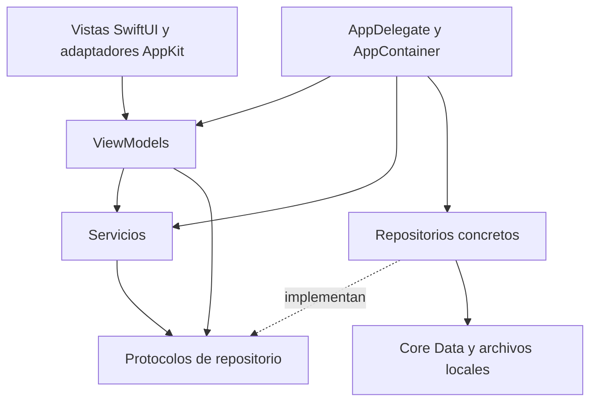

# Arquitectura

Arquitectura objetivo definida en fase 0. La fase 1 implementa arranque, composición, stack, perfil y pantalla inicial; los servicios de entrenamiento, catálogos, onboarding y navegación completa descritos aquí se incorporan en las fases posteriores del [plan](PLAN_DE_FASES.md).

## Capas y dependencias

MVVM con servicios de aplicación y repositorios por protocolo. La presentación no consulta Core Data ni calcula métricas de entrenamiento.

Los modelos de dominio son valores compartidos por las capas. Los DTO de importación/exportación son contratos versionados separados del esquema Core Data.

| Capa | Responsabilidad y frontera |
| --- | --- |
| `App` | Crear y retener dependencias, ventanas, comandos y selección de módulos. |
| `Models/Domain` | Tipos de ejercicio, rutina, prescripción, sesión, serie, medidas, unidades y errores de dominio. Sin imports de SwiftUI ni Core Data. |
| `Models/Persistence` | Stack, modelo `.xcdatamodeld` versionado, entidades `*Entity` y mapeos a valores de dominio. |
| `Repositories/Protocols` | Contratos de lectura, escritura y observación de cambios. |
| `Repositories/CoreData` | Fetch, validación de persistencia, orden y transacciones. Nunca entrega objetos administrados fuera de su contexto. |
| `Services` | Casos de uso que coordinan repositorios, reloj, notificaciones y archivos. |
| `ViewModels` | Estado observable, validación de formularios y acciones; dependen de protocolos. |
| `Views` | Renderizar estados y emitir acciones. AppKit se integra con adaptadores. |
| `DesignSystem` | Colores semánticos, iconos, tipografía y componentes accesibles. |

Los ViewModels publican siempre en la cola principal. Los métodos asíncronos de repositorio usan completions `Result<Value, Error>`; la observación usa publishers de Combine. Ninguna capa utiliza concurrencia Swift moderna.

## Composición y lifecycle

`FitTrackApplication` es el único punto `@main`: su `static main()` configura `NSApplication.shared`, retiene `AppDelegate` durante `run()` y entra en el bucle AppKit. El archivo no se llamará `main.swift`.

`AppDelegate` retiene el `AppContainer`, el controlador de ventana y los observadores del ciclo de vida. `AppContainer` crea una sola instancia de stack, repositorios, servicios de sesión/temporizadores y preferencias. También retiene los ViewModels de larga duración. Las vistas reciben instancias mediante inicializadores `@ObservedObject`; `@EnvironmentObject` solo para estado global explícito. No se crean ViewModels en `body`.

El primer arranque pasa por carga del almacén, validación/importación del catálogo y onboarding. Un error de Core Data muestra una pantalla recuperable con reintento y acceso a restauración; nunca borra la base para «arreglar» el fallo. El cierre guarda el borrador activo y los cambios pendientes; si falla, ofrece reintentar antes de salir.

## Servicios y contratos previstos

| Servicio | Función y dependencia sustituible |
| --- | --- |
| `SeedService` | Validar e importar catálogo y plantillas en una transacción; repositorios de catálogo y rutinas. |
| `WorkoutSessionService` | Iniciar, pausar, recuperar, completar series y terminar; repositorio de sesiones y reloj. |
| `RestTimerService` | Iniciar, extender, ajustar y saltar descanso; reloj y notificaciones. |
| `IntervalTimerService` | Máquina de estados HIIT/EMOM, trabajo/descanso/rondas, recuperación tras suspensión. |
| `PRDetectionService` | Comparar una serie con la mejor marca anterior y las series previas de la sesión. |
| `StatisticsService` | Agregar sesiones completadas, métricas y series temporales; calendario y zona horaria inyectables. |
| `MeasurementService` | Validar medidas, convertir unidades y producir estimaciones; fórmulas puras comprobables. |
| `ExportService` / `ImportService` | Rutinas, sesiones, CSV y backup completo; acceso a archivos mediante protocolo. |
| `NotificationService` | Autorización, programación, sustitución y cancelación; adaptador de `UNUserNotificationCenter`. |
| `SettingsService` | Unidades, apariencia, idioma, sonido y onboarding; adaptador de `UserDefaults`. |

## Sesión y recuperación

Estados explícitos: `idle`, `running`, `resting`, `paused`, `completed`, `cancelled`. Pausar registra el estado anterior para poder reanudarlo. Solo hay una sesión activa; un UUID identifica cada serie y hace idempotente la acción de completarla.

1. Al iniciar una rutina, se copia la prescripción a una sesión. Cambiar la rutina después no altera el entrenamiento abierto ni el historial.
2. Al completar una serie, se valida la entrada, se compara con el histórico y se guarda la serie, el posible PR y el nuevo estado en una transacción.
3. Solo tras el guardado se publica el resultado y se inicia el descanso. Si el guardado falla, no se avanza el índice ni se pierde la entrada del usuario.
4. El descanso registra su vencimiento; un tick solo refresca la presentación. Extender o saltar sustituye/cancela la misma notificación identificada por sesión y serie.
5. Al reactivar la app se recalcula el tiempo pendiente. Un descanso vencido se cierra una vez. Las notificaciones son una ayuda; su autorización no condiciona registrar entrenamientos.
6. Finalizar guarda la fecha, duración activa y estado; invalida la sesión activa y actualiza historial y estadísticas. Cancelar conserva un borrador recuperable o elimina los datos solo mediante una acción explícita.

La pausa excluye tiempo del cronómetro activo. El sueño del Mac no permite prometer audio puntual; al volver se reconstruye el estado. Estos casos tienen pruebas específicas.

## Persistencia y archivos

Un único `NSPersistentContainer` con almacén SQLite en Application Support dentro del contenedor de la app. `viewContext` se utiliza en su cola principal y los trabajos de catálogo/importación en contextos privados mediante `perform`. Se intercambian IDs y valores, nunca `NSManagedObject` entre colas.

Los repositorios emiten cambios después de guardar. Los contextos refrescan mediante políticas de merge explícitas. Un ViewModel actualiza consultas con debounce cuando corresponda y representa `loading`, `loaded`, `empty` o `failed`, conservando datos válidos si un refresco falla.

Las fotos se copian al contenedor y se referencian por identificador relativo. La restauración valida primero un almacén temporal y los adjuntos; sustituye el estado de forma coordinada y con posibilidad de volver al anterior. No se copia un SQLite abierto ignorando sus archivos WAL.

## Interfaz de escritorio

Sidebar: Inicio, Ejercicios, Rutinas, Entrenar, Historial, Progreso, Medidas y Herramientas. Ajustes y Acerca de se abren desde menús AppKit. La selección usa identificadores estables y un estado de navegación observable.

`NSWindow` aloja el contenido SwiftUI. `NSToolbar`, `NSSearchField` y `NSMenu` proporcionan búsqueda y comandos. Si la prueba de tres columnas con `NavigationView` no ofrece el comportamiento necesario en Catalina, un `NSSplitViewController` contiene tres `NSHostingController` sin cambiar ViewModels.

Los atajos pasan por el responder chain y validación de comandos. Espacio completa una serie solo cuando el foco no está editando texto. Se prevén Cmd+N, Cmd+S, Cmd+F, Cmd+R y Cmd+,; la lista final se verificará con VoiceOver y edición de formularios.

El drag & drop de días y ejercicios se adapta con `NSOutlineView`/`NSTableView` si es necesario. Acciones «Subir»/«Bajar» equivalentes mantienen el reordenamiento accesible por teclado. No se introducen APIs posteriores a Catalina como solución de último momento.
